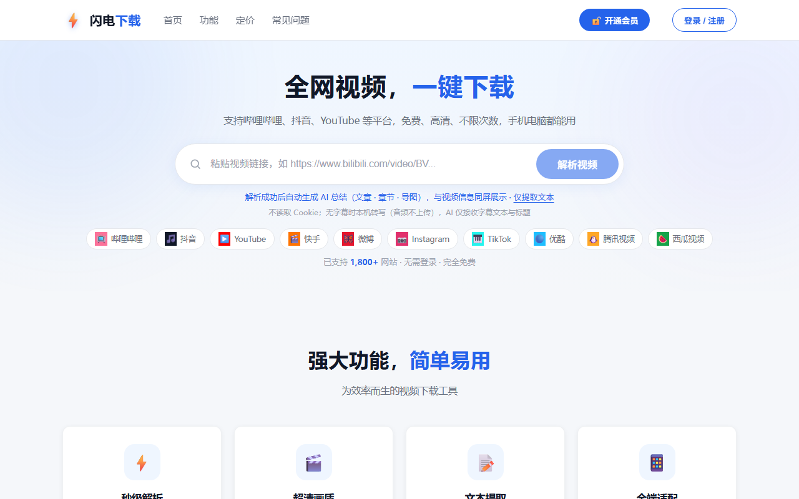
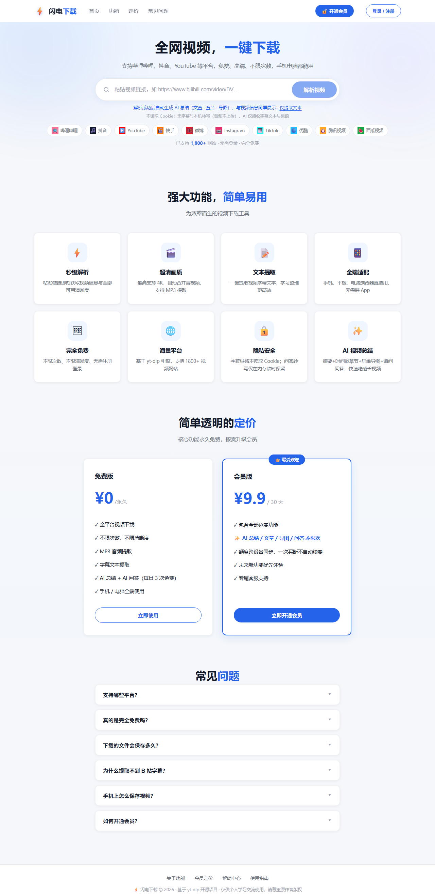

# ⚡ 闪电下载 — 全网视频下载 + AI 内容总结

粘贴链接，一键下载全网视频（支持哔哩哔哩、抖音、YouTube 等 1800+ 平台）；一键提取字幕文本，AI 生成摘要 / 时间戳章节 / 思维导图 / 流式总结文章，支持多轮追问。下载与文本提取永久免费，AI 功能每日 3 次免费额度，¥9.9 买断 30 天会员不限次。

> **V1 已收尾**（2026-10）：视频下载 → 文本提取 → AI 总结 → 账号 / 额度 / Stripe 会员支付全链路交付，后端 62 项 + 前端 12 项测试全部通过。

## 截图

**首页首屏**（解析输入 + 平台支持带）：



**整页一览**（功能区 → ¥9.9 定价区 → FAQ）：



## 技术栈

- **后端**：Python 3.10+ / FastAPI 单进程（同时服务 API 与前端静态页）、[yt-dlp](https://github.com/yt-dlp/yt-dlp) 子进程封装（零修改）、ffmpeg 合并转码、SQLite（stdlib，WAL 模式）、Stripe 官方 SDK
- **前端**：Vue3 单页应用（**本地 vendor、零构建、无 CDN 依赖**）；`/pay/` 支付回跳页为独立无框架静态页
- **LLM**：OpenAI 兼容协议（默认智谱 GLM `glm-4-flash`），纯 stdlib urllib 实现，带重试与总时限兜底

## 快速开始

### 方式一：一键启动（Windows 推荐）

双击 `start.bat`（或在 cmd / PowerShell 中运行）：

- 首次运行自动创建虚拟环境并安装依赖，之后直接启动
- 自动检测 ffmpeg（缺失仅警告：合并/MP3 转码将不可用）
- 端口已被占用时不重复启动，直接打开浏览器
- 启动约 3 秒后自动打开 [http://127.0.0.1:8000](http://127.0.0.1:8000)

### 方式二：手动启动（Python 3.10+；ffmpeg 需在 PATH）

```bash
python -m venv .venv
.venv/Scripts/python.exe -m pip install -r requirements.txt
.venv/Scripts/python.exe backend/main.py
# 访问 http://127.0.0.1:8000
```

### 配置 AI 与支付（可选）

复制 `backend/local_config.example.py` 为 `backend/local_config.py`，填入自己的密钥（该文件已 gitignore，绝不入库）：

```python
LLM_API_KEY = "sk-你的智谱APIKey"        # AI 总结/问答必配；也可用环境变量 LLM_API_KEY
STRIPE_SECRET_KEY = "sk_test_..."        # 不配则会员入口显示配置指引，不影响其他功能
STRIPE_WEBHOOK_SECRET = "whsec_..."      # stripe listen 转发或 Dashboard 获得
```

完整 Stripe 联调流程（测试账户 → CLI 转发 → `4242` 测试卡走通全链路）见 [docs/Stripe接入指南.md](docs/Stripe接入指南.md)。

## 功能

| 功能 | 说明 | 状态 |
|---|---|---|
| 视频解析 | 粘贴链接获取标题/封面/时长/清晰度（4K~360P、MP3） | ✅ |
| 视频下载 | 服务器下载合并 mp4 / 提取 MP3，实时进度（速度/ETA），文件保留 2 小时 | ✅ |
| 抖音免 Cookie | 个人主页弹窗链 / 视频链 / `v.douyin.com` 短链均可解析，**无水印 720P + MP3**，全程无需任何 Cookie | ✅ |
| 文本提取 | 一键提取字幕/自动字幕为纯文本，可复制/下载 .txt；B 站走免 Cookie 直连接口秒级取字幕（含平台 AI 字幕），失败回退 yt-dlp，再回退本机 Whisper 转写 | ✅ |
| 分步内容分析 | **解析即总结**：视频信息与 AI 总结同屏分栏，右栏 5 Tab 切换（总结/章节/导图/文本/问答），失败可重试 | ✅ |
| AI 总结 + 问答 | 摘要 / 时间戳章节要点 / 关键词 / 思维导图（全屏、拖拽缩放、PNG 下载）/ **流式总结文章（SSE 逐段渲染，可下载 .md）**，多轮追问 | ✅ |
| 账号与额度 | 邮箱账号体系（核心下载/提取免登录，超 AI 额度或购买时才登录）；免费 AI 额度每日 3 次（匿名按 IP / 登录按账号），会员不限次 | ✅ |
| 会员 · Stripe 支付 | **Stripe 托管收银台** ¥9.9 买断 30 天（不自动续费）；webhook 验签 + 事件去重 + 订单状态机幂等履约；兑换码 VIP2026/DOWN8888（服务端校验，每账号一次，无 Stripe 时可演示会员） | ✅ |
| SEO / GEO | TDK / OG / JSON-LD（含 FAQPage）/ robots / sitemap / llms.txt / `/guides/` 教程落地页 | ✅ |

## 架构

```
浏览器 ──▶ FastAPI 单进程 (127.0.0.1:8000)
             ├─ /api/*        JSON API（解析/下载/分析/账号/额度/支付）
             ├─ /pay/*        Stripe 回跳静态页（success / cancel）
             └─ /             前端静态站 (StaticFiles)
                      │
                      ├─ yt-dlp 子进程 + ffmpeg        视频下载/合并/转码
                      ├─ 抖音免 Cookie 分享流通道        无水印 720P
                      ├─ B站免 Cookie 字幕直连 → yt-dlp → 本机 Whisper（逐级回退）
                      ├─ LLM (OpenAI 兼容 / GLM)        总结/文章/导图/问答
                      ├─ SQLite (data/app.db, WAL)      账号/会话/订单/额度/兑换码
                      └─ Stripe Checkout + Webhook      托管收银台 + 幂等履约
```

支付关键链路：`POST /api/vip/checkout`（服务端定价）→ Stripe 收银台 → 回跳 `/pay/success.html` 轮询订单 → webhook `construct_event` 验签 → `webhook_events` 按 event_id 去重 → `mark_order_paid` 条件更新**幂等履约**（会员 +30 天 + 发激活码）；webhook 丢失时成功页轮询触发后端**主动向 Stripe 核实**，走同一幂等入口（双保险）。

## 安全设计

- **密码**：stdlib `scrypt` 加盐哈希 + `secrets.compare_digest` 恒时比较；登录失败不区分"账号不存在/密码错误"（防枚举）
- **会话**：`secrets.token_urlsafe(32)` 令牌，库中只存 SHA-256 摘要；`HttpOnly + SameSite=Lax` Cookie，30 天有效
- **支付**：金额只来自服务端 `config.PLANS`（客户端无法传价）；webhook 强制验签（防伪造/重放）+ 事件去重 + SQL 条件更新防并发双续期；每账号每套餐至多一个 pending 订单（部分唯一索引）防重复付款
- **额度**：HTTP 入口预扣（AI 失败不退还，防重试刷量）；注册/登录每 IP 每分钟 10 次限流
- **隐私**：`backend/local_config.py`（真实密钥）与 `data/app.db`（账号/订单）均已 gitignore，绝不入库

## 测试

```bash
# 后端 62 项（db 12 / auth 7 / quota 8 / payments 20 / analysis 15），全离线可跑
.venv/Scripts/python.exe -m unittest discover -s tests -p "test_*.py"

# 前端 12 项（node:test + vm 沙箱，覆盖视频总结交互与 402/登录/支付弹窗流转）
node --test tests/test_frontend.js
```

支付测试不依赖外网：Stripe 网络层 mock，webhook 验签走真实 SDK 并手工构造 Stripe 规范的 HMAC-SHA256 签名头；重复投递、并发履约、坏签名、400 秒重放、他人订单访问等均有断言。

## 项目结构

```
├── backend/         # FastAPI 入口 + yt-dlp 封装 + 抖音通道 + 字幕提取 + LLM + 账号/额度/支付
│   ├── main.py      #   路由挂载 + 静态托管
│   ├── analysis_api.py / summarize_api.py    # 分步分析（SSE）与 AI 总结/问答
│   ├── auth_api.py / quota.py / payments_api.py / stripe_gateway.py / stripe_config.py
│   ├── db.py        #   SQLite 持久层（7 张表，短连接 + WAL）
│   ├── local_config.example.py               # 密钥配置模板（复制为 local_config.py 使用）
│   └── config.py    #   定价/额度/会话/兑换码等全局配置
├── frontend/        # Vue3 单页（本地 vendor 零构建）；pay/ Stripe 回跳页；guides/ 教程落地页
├── docs/            # 需求/设计/总结/竞品/SEO/GEO/Stripe 指南（10 份）+ images/ 截图
├── tests/           # unittest 后端 + node:test 前端 + fixtures
├── downloads/       # 临时文件（2 小时自动清理）
└── data/            # SQLite 本地库 app.db（账号/订单/额度，gitignored）
```

## 配置项（`backend/config.py`）

| 配置 | 默认 | 说明 |
|---|---|---|
| `PLANS` | `monthly` ¥9.9 / 30 天 | 会员档位（金额存最小货币单位，服务端定价） |
| `FREE_AI_PER_DAY` | `3` | 免费用户每日 AI 次数（环境变量可调） |
| `SESSION_TTL_SECONDS` | 30 天 | 登录会话有效期 |
| `PUBLIC_BASE_URL` | `http://127.0.0.1:8000` | 支付回跳地址，部署时改为公网域名 |
| `VIP_CODES` | `VIP2026` / `DOWN8888` | 演示兑换码（每账号一次，各送 30 天） |
| `ASR_PYTHON` / `ASR_MODEL` | 系统 Python / `base` | 本机 Whisper 转写的解释器与模型 |

## API 概览

- `POST /api/parse` `{url}` → 视频信息 + 清晰度列表
- `POST /api/download` `{url, quality, title}` → `{task_id}`；`GET /api/tasks/{id}` 进度；`GET /api/file/{id}` 取文件
- `POST /api/extract-text` `{url}` → `{title, text, chars}`
- `POST /api/analyze` `{url, include_summary?}` → 分步分析任务；`GET /api/analysis/{id}` 进度与结果；`POST /api/analysis/{id}/summarize` 补生成 AI 总结；`POST /api/analysis/{id}/retry` 重试（任务 60 分钟惰性清理）
- `POST /api/summarize` `{url}` → 摘要/章节/关键词/导图一步到位；`POST /api/qa` → 多轮追问（均需 LLM Key，消耗额度）
- `POST /api/auth/register|login|logout`、`GET /api/auth/me` → 邮箱账号
- `GET /api/quota` → 当日 AI 额度（模式/上限/已用/剩余）
- `GET /api/vip/plans`、`POST /api/vip/checkout`、`GET /api/vip/order/{id}`、`POST /api/vip/activate`、`POST /api/webhooks/stripe` → 会员支付
- 完整契约见 `docs/方案设计.md` 与 `docs/方案设计-会员支付.md`；交互式文档 `http://127.0.0.1:8000/api/docs`

## 已知限制（二期方向）

- 需登录内容（如 B 站 1080P+ 部分）匿名仅能获取较低清晰度；计划支持 Cookie 配置
- 文本链路不读取浏览器 Cookie；B 站优先免 Cookie 直连取平台字幕，失败回退 yt-dlp 公开字幕，再回退本机 Whisper（需自装 `openai-whisper` + PyTorch，音频不上传）；无法匿名获取音频的视频仍不可提取
- 抖音免 Cookie 通道为无水印 720P 单一清晰度 + MP3，暂不支持多清晰度；抖音无字幕接口，文本提取需等二期转写
- 小红书等少数平台暂不支持；YouTube 等境外平台需服务器网络可达
- 使用 AI 时，字幕文本与视频标题会发送给所配置的 LLM 服务商；分析任务与问答会话存于进程内存，重启后丢失
- 账号为邮箱+密码（无邮箱验证，找回密码需管理员清库）；匿名 AI 额度按 IP 记，代理可绕过；退款未自动回收会员，需人工处理
- 上线前需替换 `frontend/index.html` 等处的占位域名（见 `docs/SEO 优化说明.md`），全站 HTTPS 后打开会话 Cookie `secure` 标记

## 相关文档

| 文档 | 内容 |
|---|---|
| `docs/需求文档.md` | 背景目标、用户故事、功能清单与免费/付费边界 |
| `docs/方案设计.md` | 架构总览、API 契约、核心流程、UI 规范、扩展指引 |
| `docs/项目总结.md` | 交付复盘：抖音免 Cookie 通道原理、踩坑记录、二期路线 |
| `docs/方案设计-AI视频总结.md` / `docs/视频总结功能总结.md` | 分步任务架构、隐私边界与最终形态、15 项回归验证 |
| `docs/竞品调研-AI视频总结.md` | BibiGPT / NoteGPT 竞品调研与商业化参照 |
| `docs/Stripe接入指南.md` | **手把手**：测试账户→密钥→CLI→webhook→测试卡全流程与 FAQ |
| `docs/方案设计-会员支付.md` | 阶段 5 设计：账号/额度/支付 ADR、契约、幂等与安全设计（含测试映射） |
| `docs/SEO 优化说明.md` / `docs/GEO 优化说明.md` | TDK/OG/JSON-LD/robots/sitemap 与 llms.txt/教程落地页改造记录 |

## 免责声明

仅供个人学习交流使用，请尊重内容创作者版权，勿用于任何侵权用途。
