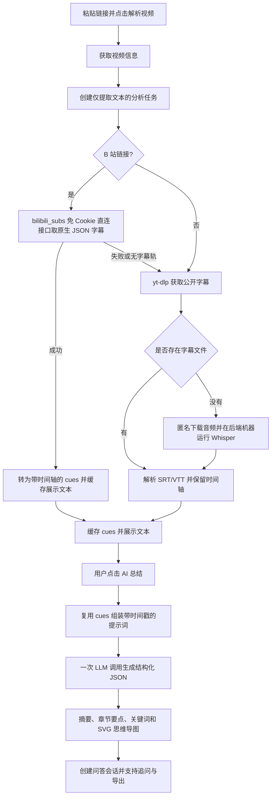

# 视频总结功能总结：需求分析与方案设计

日期：2026-10-13（2026-10-15 更新：B 站直连字幕通道、LLM 调用健壮性、导图本地构建）

状态：分步文本提取、AI 总结、思维导图和视频问答已实现。本文按当前代码记录最终交互与技术边界；早期方案、竞品调研和历史测试记录保留在其他文档中。

## 1. 交付目标与结果

将视频内容整理为可阅读、复制和导出的文字稿与学习笔记。用户先查看文本，再决定是否调用 AI，以减少不必要的请求和费用。

最终操作流程：

1. 粘贴视频链接，点击 **解析视频**，展示视频信息并自动提取文本。
2. 文本提取成功后，直接在页面展示完整文本，可复制或下载 TXT。此步骤不调用语言大模型。
3. 点击 **AI 总结**，复用同一任务的字幕时间轴，在一次大模型请求中生成摘要、章节要点、关键词和思维导图数据。
4. 总结和导图直接展示在页面；点击已完成任务的 AI 总结按钮可查看详情并进行视频问答。
5. AI 失败时保留文本，用户可重试；解析另一个视频时清空旧结果，旧请求不能覆盖新视频的结果。

## 2. 需求分析

### 2.1 背景与用户诉求

用户观看长视频后，需要提取内容、定位重点、整理知识结构，并继续提问。单纯下载视频不能完成这些任务；直接自动调用 AI 又会在只想查看文本时产生不必要的费用。

本期明确的输入是**粘贴视频链接**。本地视频文件上传不是当前交付入口。

### 2.2 功能需求与验收标准

| 需求 | 最终行为 | 验收标准 |
|---|---|---|
| 视频解析 | 返回标题、封面、时长、清晰度等信息 | 解析成功后仍可下载视频，内容处理不阻塞下载操作 |
| 自动提取文本 | 解析成功后创建仅提取文本的任务 | `include_summary=false`，成功后 `summary_status=idle`，不调用 LLM、不消耗 AI 限流额度 |
| 单独提取文本 | 不先解析下载信息，也可点击提取视频文本 | 创建文本任务，已提取的文本直接复用，不自动生成 AI 内容 |
| 手动生成总结 | 点击 AI 总结后调用大模型 | 摘要、章节要点、关键词和导图一起返回；已有文本时不重复提取字幕 |
| 思维导图 | 展示主题、章节和要点之间的关系 | 点击 AI 总结前不显示导图；生成后可折叠节点，全部节点完整显示 |
| 结果导出 | 文本支持 TXT；总结支持 Markdown / TXT | 页面提供复制与下载按钮 |
| 视频问答 | 基于本次总结的转写会话回答问题 | 使用 `session_id`，历史最多取最近六条消息，回答提示要求引用时间戳并避免编造 |
| 失败重试 | 提取失败重试提取；AI 失败重试 AI | 文本任务重试不调用 LLM，AI 重试保留并复用已提取文本 |
| 切换视频 | 每次解析重置文本、总结、导图及问答状态 | 延迟返回的旧请求不写入当前视频 |

### 2.3 非功能要求

- **费用可控**：用户点击 AI 总结才调用模型；总结和导图合并生成；重复查看结果不重复请求。
- **响应清晰**：异步任务分别记录文本与 AI 状态，显示等待、处理中、成功和失败信息。
- **隐私边界明确**：字幕链路不读取浏览器 Cookie 或 `backend/cookies.txt`；转写音频不发送给语言大模型。调用 AI 时，文本和标题会发送给配置的服务商。
- **依赖轻量**：Vue 3 本地脚本、零构建；FastAPI 托管前端与 API；使用 Python 标准库 `urllib` 调用 OpenAI 兼容接口。
- **资源有上限**：内容任务使用信号量控制并发，任务缓存与问答会话分别设置容量和有效期。

## 3. 方案设计

### 3.1 总体架构



字幕获取按「B 站直连 → yt-dlp → Whisper」三级回退：B 站直连仅两个轻量 HTTP 请求即可拿到平台 AI 字幕（ai-zh）等字幕轨（实测秒级，yt-dlp 匿名状态下常拿不到），任何失败静默回退下一级，原行为不变。上述 Whisper 回退发生在字幕获取命令成功结束、但没有字幕文件的情况下。平台访问失败、需要登录或字幕内容为空时，会返回相应错误，不保证所有失败都能转写回退。抖音文本链路目前会提前返回暂不支持的提示。走 Whisper 转写（lang=zh-asr）时，前端在文本卡明确提示「该视频没有平台字幕轨，文本由本地语音转写生成」。

### 3.2 模块职责

| 模块 | 职责 |
|---|---|
| `backend/main.py` | 视频解析与下载接口、业务错误处理、静态文件托管、分析路由接线与任务关闭 |
| `backend/analysis_api.py` | 内容任务创建、轮询、显式触发总结、重试、字幕缓存、并发控制 |
| `backend/bilibili_subs.py` | B 站免 Cookie 直连字幕通道：view/dm/view 接口取字幕列表，直下原生 JSON 转为 cues；失败返回 None 交由上层回退 |
| `backend/subtitle_cues.py` | B 站直连优先；否则下载字幕转换为 `{start, end, text}`，没有字幕文件时调用转写回退 |
| `backend/text_extractor.py` | 保留旧纯文本接口及字幕解析能力；同样支持可选转写回退 |
| `backend/local_transcriber.py` | 探测 Whisper/PyTorch 运行环境，匿名下载音频，在后端机器上以 CPU 推理生成文本与时间轴 |
| `backend/summarizer.py` | LLM 请求、提示词、JSON 校验、导图规范化、问答会话和 IP 限流 |
| `backend/llm_config.py` | 读取环境变量及被 Git 忽略的本地模型配置 |
| `frontend/js/app.js` | 两阶段交互、状态轮询、结果缓存、请求版本校验、SVG 布局、导出与问答 |
| `frontend/index.html` / `frontend/css/style.css` | 文本、总结、导图和弹窗展示，桌面与手机布局 |

### 3.3 两阶段任务与缓存复用

`POST /api/analyze` 的 `include_summary` 默认是 `false`。文本任务完成后进入 `status=done`，而 AI 状态保持 `idle`。因此，任务完成不代表已经生成 AI 总结，前端分别判断各阶段状态。

点击 AI 总结时调用 `POST /api/analysis/{task_id}/summarize`：

- 已有 `meta.cues`：直接进入总结阶段，复用字幕及时间轴。
- 正在提取文本：记录总结意图，在本次提取完成后继续处理，不创建重复提取任务。
- 已经请求、正在生成或已生成总结：返回当前任务，不重复创建工作任务。
- 已失败：显式请求可重新安排处理；已有文本时仅重新生成 AI 内容。
- 已过期或被淘汰：返回 404，前端重新创建任务。

分析任务存于服务进程内存，容量为 `config.MAX_TASKS`（默认 100）。完成的任务按完成时间计算 60 分钟有效期；在创建和查询任务时惰性清理，容量不足时淘汰最早完成的任务。任务没有数据库持久化，重启后消失。这是逻辑有效期，不是到点立即擦除内存的定时机制。

### 3.4 状态设计

| 场景 | `status` | `text_status` | `summary_status` | `summary_requested` |
|---|---|---|---|---|
| 仅文本任务排队 | `queued` | `pending` | `idle` | `false` |
| 提取文本中 | `extracting` | `extracting` | `idle` | `false` |
| 文本完成，等待用户决定 | `done` | `done` | `idle` | `false` |
| 用户请求 AI，正在排队 | `queued` | `done` | `pending` | `true` |
| AI 生成中 | `summarizing` | `done` | `generating` | `true` |
| 全部完成 | `done` | `done` | `done` | `true` |
| 仅文本提取失败 | `error` | `error` | `idle` | `false` |
| 已请求 AI，但文本提取失败 | `error` | `error` | `error` | `true` |
| AI 失败，文本保留 | `error` | `done` | `error` | `true` |

API 返回 `text_error` 与 `summary_error`，前端分别展示。内部 `meta`、来源 URL、客户端 IP 和完成时间不通过任务视图返回。

### 3.5 LLM 输出与思维导图

输入由视频标题、输出结构要求和带 `[分:秒]` 的字幕组成。`build_transcript` 将带时间戳的转写控制在约 30,000 字符内；超长时截断，并在提示词中说明仅依据给定部分总结。模型只需输出以下字段（思维导图不再请求模型生成——其内容与章节要点完全重复，白白翻倍输出 token 拖慢生成——而是由服务端按章节本地构建）：

```json
{
  "summary": "视频核心摘要",
  "chapters": [
    {"title": "章节标题", "start": 12.4, "points": ["章节要点"]}
  ],
  "keywords": ["关键词"]
}
```

LLM 传输层健壮性：HTTP 调用放入独立线程并施加总时限（`LLM_TIMEOUT_SECONDS + 5s`），防止缓慢滴流的响应无限重置单次读超时导致任务挂死；502/503/504、连接中断（如 `IncompleteRead`）、读超时等瞬时故障自动重试最多 3 次（递进退避），仍失败才返回友好错误并建议稍后重试或切换服务商。

服务端解析 JSON、整理章节和字符串字段，并按章节起点排序。模型输出无效 JSON 或没有有效章节时，追加修正提示，最多再调用一次；网络或服务错误直接提示失败，不进行这次格式重试。针对配置的 DeepSeek 官方端点，总结请求会增加 `response_format={"type":"json_object"}`。

导图最多保留主题、章节、要点三层，节点标签规范化到 12 字符，一律根据已生成的章节要点构建（模型若仍返回 mindmap 字段则优先采用）。前端使用 SVG 绘制连接线与节点，按树的叶节点数量计算宽高，点击有子节点的节点可折叠；绘图本身不产生模型费用。

### 3.6 前端请求隔离

每次解析或切换输入源增加 `analysisVersion`，清空结果与计时器。创建任务、轮询、AI 请求及问答响应写入状态前，都校验请求版本。轮询同时校验 `taskId`，以免旧任务污染当前视频。

分析轮询采用请求完成后再安排下一次 `setTimeout`，间隔 800ms，不使用会叠加未完成请求的轮询方式。终态停止轮询；网络失败展示可重试状态。AI 尚未被请求时，只显示文本卡片；点击后才显示总结和导图卡片。

## 4. API 契约

| 方法与路径 | 请求 | 用途 |
|---|---|---|
| `POST /api/parse` | `{url}` | 获取视频信息；前端成功后另行创建文本任务 |
| `POST /api/analyze` | `{url, include_summary?: false}` | 默认仅提取文本；显式 `true` 支持直接请求完整分析 |
| `GET /api/analysis/{task_id}` | 无 | 查询阶段状态、错误、`text_result` 和 `summary_result` |
| `POST /api/analysis/{task_id}/summarize` | 空 JSON 对象即可 | 用户主动生成总结和导图，复用已有字幕 |
| `POST /api/analysis/{task_id}/retry` | 空 JSON 对象即可 | 按原任务的总结意图重试 |
| `POST /api/qa` | `{session_id, question, history}` | 基于总结转写的多轮问答 |
| `POST /api/extract-text` | `{url}` | 保留的纯文本同步响应接口 |
| `POST /api/summarize` | `{url}` | 保留的直接总结接口，会重新提取字幕；当前页面优先使用任务接口 |

`text_result` 包含 `title/text/chars/lang`；`summary_result` 包含 `session_id/title/transcript/summary/chapters/keywords/mindmap/model/elapsed/chars/lang`。任务不存在或过期返回 404，业务失败通过任务状态或业务错误提示表达。交互文档地址为 `http://127.0.0.1:8000/api/docs`。

## 5. 配置、运行与费用控制

### 5.1 启动

Windows 双击 `start.bat`，或运行：

```powershell
python -m venv .venv
.venv/Scripts/python.exe -m pip install -r requirements.txt
.venv/Scripts/python.exe backend/main.py
```

默认地址为 `http://127.0.0.1:8000`，仅监听本机。修改后端后需重启服务，修改前端后刷新页面。原启动脚本在端口已占用时直接打开页面，不会自动停止旧服务。

### 5.2 配置项

| 配置 | 默认值／用途 |
|---|---|
| `LLM_API_KEY` | 必需；未配置时 AI 返回错误，已提取文本仍保留，不降级为本地摘要 |
| `LLM_BASE_URL` | OpenAI 兼容端点；默认智谱，DeepSeek 可配置为 `https://api.deepseek.com` |
| `LLM_MODEL` | 默认 `glm-4-flash`；使用其他服务商时填写账号可用的模型名 |
| `LLM_TIMEOUT_SECONDS` | 单次调用默认 90 秒；同时作为该次调用的总时限（+5s 兜底），瞬时失败自动重试最多 3 次 |
| `LLM_MAX_TOKENS` | 单次输出默认上限 4096 Token |
| `ASR_PYTHON` | 可选，指定安装 Whisper/PyTorch 的 Python |
| `ASR_MODEL` | 默认 `base` |
| `ASR_MODEL_CACHE` | 可选，模型缓存目录 |
| `ASR_TIMEOUT_SECONDS` | 本地推理默认超时 900 秒 |

LLM 配置优先读取环境变量，其次 `backend/local_config.py`。ASR 配置读取环境变量。`openai-whisper`、PyTorch 和 FFmpeg 属于可选转写运行环境，不包含在基础 `requirements.txt` 中；首次转写可能需要下载模型权重。当前转写设置为中文、CPU 推理。

### 5.3 费用与数据边界

- 获取字幕不调用语言大模型；Whisper 在后端机器运行，不产生 DeepSeek API 费用，但会使用本地算力和下载资源。
- 一次总结与导图通常合并为一次模型请求；格式重试、用户主动重试及追问会追加调用。
- AI 总结和问答共用每 IP 每分钟三次限流；只提取文本不计入该限流。
- 计费取决于服务商、模型、输入与输出 Token、缓存及可能的思考输出；当前代码没有保存 API `usage`，不提供实测账单或精确费用统计。
- LLM 服务商接收视频标题与转写文本，不接收原始视频或转写音频。问答会话缓存上限 50 条、逻辑有效期 60 分钟，采用访问时校验和创建时清理。
- API Key、Cookie、本地配置、日志、模型缓存和视频下载产物不应提交到 Git；当前 `.gitignore` 已覆盖项目内主要运行产物与本地凭据文件。

## 6. 验证结果

本次交付包含 **11 项后端回归测试、4 项前端流程测试，共 15 项通过**。字幕获取与模型结果在回归中使用模拟数据，不依赖外部网络或收费模型调用。

| 验证项 | 结果 |
|---|---|
| 默认任务仅提取文本、没有模型调用及 AI 限流消耗 | 通过 |
| 用户点击 AI 总结后调用模型，并复用同一份 cues | 通过 |
| 提取过程中接到 AI 请求、重复请求不追加重复工作 | 通过 |
| 文本提取失败与 AI 失败的分类重试 | 通过 |
| AI 限流或失败时保留已提取文本 | 通过 |
| 视频切换时旧响应无法覆盖新结果 | 通过 |
| 独立提取文本按钮不调用 AI | 通过 |
| 导图缺失、分支格式错误及超出三层的处理 | 通过 |
| URL 校验、缺失任务、缓存过期与路由契约 | 通过 |
| 浏览器：解析后只显示文本，点击 AI 总结后显示总结与导图 | 通过，使用本地字幕夹具及模拟 AI 响应 |
| 浏览器：生成结果、导图高度与折叠、控制台错误检查 | 通过 |
| 本机 8000 端口健康接口、页面及最新路由 | 通过 |

复现命令：

```powershell
.venv/Scripts/python.exe -m unittest discover -s tests -p 'test_*.py' -v
node --test tests/test_frontend.js
node --check frontend/js/app.js
git diff --check
```

Node 仅用于前端流程回归，不是启动页面的必要依赖。真实平台的匿名字幕、音频可达性，以及所配置服务商的实时可用性，不由模拟回归结果保证；本次未将旧文档的历史真模型测试视为新的实测结果。

### 6.1 真实平台实测（2026-10-15）

| 场景 | 结果 |
|---|---|
| B 站视频 BV1cupk62EoH（鱼皮搬家 vlog，10:45）字幕提取 | ✅ 直连通道约 0.8~3 秒拿到 `ai-zh` 字幕（251 条 cues / 3044 字）；此前同一视频 yt-dlp 匿名拿不到字幕，走 Whisper CPU 转写需数分钟 |
| 分步流程端到端（解析 → 文本 → AI 总结） | ✅ 智谱 `glm-4-flash` 总结 22.7 秒，全流程 24 秒；12 个带时间戳章节 + 关键词 + 12 分支导图，UI 完整渲染 |
| LLM 服务商故障切换演练 | ✅ DeepSeek V4 Flash 当日服务端过载（网关 503 瞬拒 / 响应挂起），新重试逻辑 3 次后约 7 秒快速失败并给出「切换服务商」提示，不再无限挂死；改配智谱后即恢复 |

## 7. 已知限制与后续方向

1. **平台可用性**：登录限制、风控、网络和字幕权限会影响提取；抖音字幕/转写入口目前明确不支持。
2. **输入与语言范围**：当前入口是视频链接；Whisper 默认中文，不包含多语言自动识别和本地文件上传。
3. **长视频完整性**：总结输入约 30,000 字符截断；后续可支持分块提取、分段总结和合并导图。
4. **任务持久化**：单进程内存任务不能跨进程共享，重启后丢失；多 worker 部署前需引入统一存储和任务队列。
5. **执行与清理**：前端停止旧轮询不会取消后端正在处理的旧任务。缓存采用惰性清理；超长转写的临时目录清理策略仍可进一步完善。
6. **费用与体验**：可增加实际 Token 用量记录、费用统计、生成耗时指标及更明确的长视频处理进度。
7. **产品扩展**：真实付费、批量分析、字幕翻译和更多导出形式均可在当前模块职责上扩展。

## 8. 关键经验

- 将文本提取与 AI 生成拆为两个用户动作，既满足只看文本的需求，也让费用意图明确。
- 复用带时间轴的字幕数据，而不仅是纯文本，能够同时支持章节起点、总结、导图和问答。
- 只处理界面显示开关不足以保证费用边界；服务端同样需要默认不生成 AI 的任务模式和显式总结接口。
- 独立记录文本与 AI 状态，允许阶段性成功，避免 AI 失败时让整份内容消失。
- JSON 约束、服务端校验与基于章节的导图补齐共同提高显示稳定性；导图布局还必须设置实际高度。
- 文档需区分最终实现、历史方案、模拟验证和真实外部服务验证，避免将早期假设当成当前行为。
